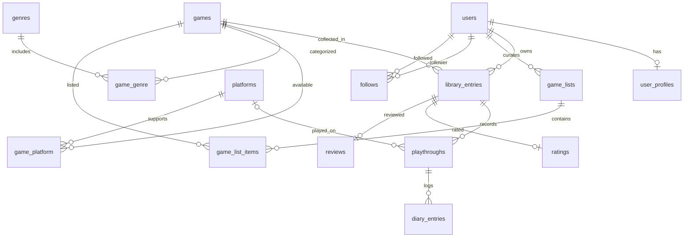

# PlayHaven domain and database

Stage 2 defines the storage model and Eloquent relationships. The catalog importer, public discovery screens, and scoped personal-library actions are now implemented on this foundation.

## Relationships



## Catalog

| Table                         | Purpose and key rules                                                                                                                                                                        |
| ----------------------------- | -------------------------------------------------------------------------------------------------------------------------------------------------------------------------------------------- |
| `games`                       | Local primary key, unique slug, nullable unique RAWG and legacy IGDB IDs, name, summary/storyline, release date, RAWG cover URL, legacy cover ID, provider update and detail-sync timestamps |
| `genres`, `platforms`         | Local primary keys, unique slugs, nullable unique RAWG and legacy IGDB IDs                                                                                                                   |
| `game_genre`, `game_platform` | Many-to-many relationships with composite primary keys, preventing duplicate associations                                                                                                    |

Local foreign keys always reference local IDs, never provider IDs. This keeps player history independent of the external provider. Metadata can be resynchronized later without recreating a game row. RAWG metadata is imported through the explicit catalog command; no demo reviews are seeded.

`developers` and `publishers` store a unique RAWG company ID, stable unique local slug, and name. `developer_game` and `game_publisher` connect companies to games through composite primary keys and cascading foreign keys. Games may have multiple developers and publishers. `games.website_url` holds the validated official website; `credits_synced_at` distinguishes older entries awaiting enrichment from checked entries with no available credits. These additive tables and columns do not modify player history.

`game_connections` stores provider relationship snapshots and curated bidirectional edges with a RAWG target ID, type, source, title/artwork/date snapshot, optional note, and source URL. `games.connections_synced_at`, `connections_checked_at`, and `connections_truncated` track refresh state. Selecting an external target imports its full local catalog record. See [game connections](GAME_CONNECTIONS.md).

## Player experience

| Table             | Purpose and key rules                                                                                                                                                         |
| ----------------- | ----------------------------------------------------------------------------------------------------------------------------------------------------------------------------- |
| `user_profiles`   | Optional profile per user; username, display name, bio, avatar path. A unique index on `LOWER(username)` prevents case-only duplicates. Multiple unset usernames are allowed. |
| `library_entries` | One row per user/game. Status is nullable: `playing`, `completed`, `paused`, or `dropped`. Null means saved without a playing status. Also stores favorite state.             |
| `playthroughs`    | Multiple runs per library entry. Optional label and platform, status, start and finish dates. A run has no backlog status; finish date cannot precede a known start date.     |
| `diary_entries`   | Sessions attached to a playthrough, with log date, optional nonnegative minutes, and notes. Multiple sessions on the same day are valid.                                      |
| `ratings`         | At most one current rating per library entry. Integer `score` between 1 and 10; no row means unrated.                                                                         |
| `reviews`         | At most one current review per library entry. Nonblank body, spoiler flag, public/private flag. Editing updates the same row.                                                 |

Playthroughs, ratings, and reviews inherit their user and game through `library_entry_id`. Diary entries inherit them through their playthrough. There are no separate user/game columns that could contradict each other.

Library status and playthrough status are independent. Starting a replay preserves the earlier run and the game's overall rating. Current history actions preserve the user's library status; changes to that status remain explicit in the library editor.

Ratings describe a player's overall opinion of a game. Replaying a game does not add another vote to community averages. A review and a rating can exist independently. A player may review/rate a game without marking it completed.

```php
$rating = new Rating(['library_entry_id' => $entry->id]);
$rating->setStars(4.5)->save(); // score = 9
$rating->stars;               // 4.5
```

`setStars()` rejects out-of-range values, fractions other than half stars, and non-finite numbers. Database constraints also protect stored values when writes bypass Eloquent.

## Community foundation

| Table             | Purpose and key rules                                                                                                                           |
| ----------------- | ----------------------------------------------------------------------------------------------------------------------------------------------- |
| `game_lists`      | User-owned lists with name, owner-scoped unique slug, description, visibility (`public`, `unlisted`, `private`)                                 |
| `game_list_items` | A game appears at most once per list; positive position and optional notes. Items sort by position then ID for deterministic ordering.          |
| `follows`         | Directed follower/followed pairs; duplicate pairs and self-following are rejected. Both relationships cascade when the related user is deleted. |

The schema permits list-position gaps or ties. The implemented list actions order by position/ID and normalize positions when reordering or removing items. Private links are restricted to their owners; unlisted links allow direct access and stay out of discovery; public lists appear in discovery. Current controllers enforce these rules with scoped ownership checks. See [custom lists](LISTS.md).

`user_profiles.is_public` defaults to false and controls player discovery, public profile access, and eligibility for community review feeds. It does not replace each review/list's visibility. Follow actions derive the follower from authentication and keep existing directed-edge constraints. Feeds query current eligible public reviews instead of duplicating private experience records into an activity table. See [community behavior and privacy](COMMUNITY.md).

The existing `user_profiles.avatar_path` stores a generated normalized-photo path on the private local disk. Controlled image routes enforce ownership/profile visibility and resource DTOs expose only photo URLs. Replacements and account/profile deletion retire stored images after commit; no avatar migration is required. See [profile photos](PROFILE_PHOTOS.md).

`profile_game_favorites` connects a profile to at most four distinct local games with unique positions 1–4, independently of library favorite flags. Completion sharing follows `user_profiles.is_public`. The legacy `share_recent_completed` column is retained for migration compatibility but is no longer read, accepted, or returned by the application. `library_entries.completed_at` tracks transitions into Completed without using metadata-edit timestamps or changing playthrough history. Old entries with unknown completion dates remain null. See [profile shelves](PROFILE_SHELVES.md).

## Ownership, deletion, and indexing

- Deleting a user cascades to their profile, library, dependent playthrough/diary/rating/review records, lists/items, and follows.
- Deleting a library entry cascades to its player history. The library UI requires confirmation with an explicit history warning; changing status updates the existing entry and preserves that history.
- A game referenced by a library entry or list item is protected by a restrictive foreign key. Catalog synchronization should update records and avoid deleting referenced games.
- Deleting a genre/platform removes its catalog associations. A deleted platform clears the optional playthrough platform reference while preserving the run.
- Indexes support user/status library filters, game lookups, diary/playthrough chronology, list ordering, and both directions of following.
- New timestamp columns use timezone-aware types on PostgreSQL. Release dates, run dates, and diary dates are calendar dates rather than instants.

## Verification and local workflow

The three new migrations are additive to the existing authentication schema. Default tests use SQLite in memory. To run the complete suite against PostgreSQL in isolation:

```powershell
powershell -ExecutionPolicy Bypass -File .\scripts\test-postgres.ps1
```

This script creates/uses **`playhaven_testing`**, clears cached configuration, verifies Laravel selects the test database, and restores process environment variables afterward. Test tables are disposable. Development database **`playhaven`** is kept separate.

Factories cover all 12 domain models. Tests exercise constraints, rating conversion, repeat playthroughs, inherited ownership, aggregate cardinality, deletion behavior, catalog relationships, list ordering, and directed follows. CI is configured to run the full suite against both PostgreSQL and SQLite.

## Next implementation stage

Private statistics at `/stats` read the existing library, ratings, playthroughs, diary, genre, and platform tables using owner-scoped aggregates. No statistics tables or history rewrites are needed. See [statistics definitions and privacy](STATISTICS.md).

The catalog, library, ratings, reviews, diary, repeat playthroughs, custom lists, opt-in player profiles, follows, and public review feeds are implemented; see [catalog workflow](CATALOG.md), [personal library](LIBRARY.md), [ratings/reviews](RATINGS_REVIEWS.md), [playing history](PLAYING_HISTORY.md), [custom lists](LISTS.md), and [community](COMMUNITY.md). Personal statistics and deeper discovery remain next.
